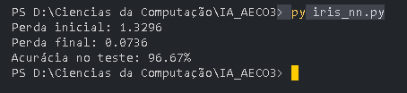

# Rede Neural Artificial para Iris

Implementação didática de uma rede neural com uma camada escondida, treinada
com gradiente descendente e backpropagation. O cálculo da rede usa somente
NumPy; o Scikit-Learn é usado para carregar, dividir e padronizar os dados.

## Requisitos

- Python 3.10 ou superior
- NumPy
- Scikit-Learn

Instale as dependências e execute

```bash
py -m pip install -r requirements.txt
py iris_nn.py
```

O programa usa as quatro características do Iris, padroniza os dados com
estatísticas calculadas somente no conjunto de treino, codifica as três classes
em one-hot e faz uma divisão estratificada de 80% para treino e 20% para teste.
Por padrão, treina por 1000 épocas e exibe a perda inicial/final e a acurácia no
conjunto de teste.

## Organização e responsabilidade (SOLID)

- `IrisDataLoader`: carrega, divide e prepara os dados.
- `NeuralNetwork`: mantém os parâmetros e implementa forward pass, perda,
  predição e gradientes.
- `Trainer`: controla as épocas e a taxa de aprendizado.
- `Evaluator`: calcula a acurácia sem alterar o modelo.
- `main`: conecta as responsabilidades e executa o fluxo.

Pesos são inicializados com He; a camada escondida usa ReLU e a saída usa
Softmax numericamente estável. A perda é entropia cruzada categórica.

## Resultado obtido

Na execução realizada, após 1000 épocas de treinamento, a perda diminuiu de
1,3296 para 0,0736. No conjunto de teste, com 30 amostras, o modelo obteve
96,67% de acurácia, classificando corretamente 29 amostras.

